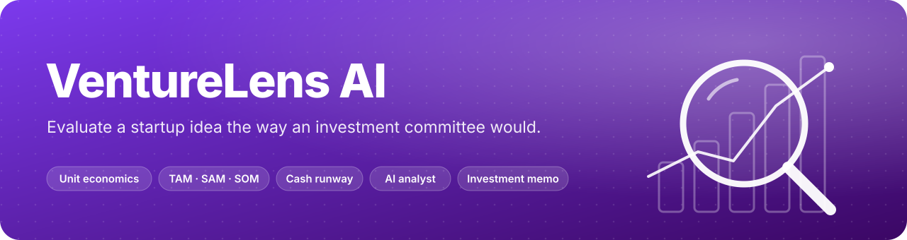
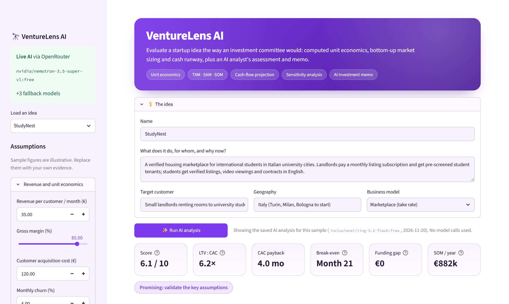
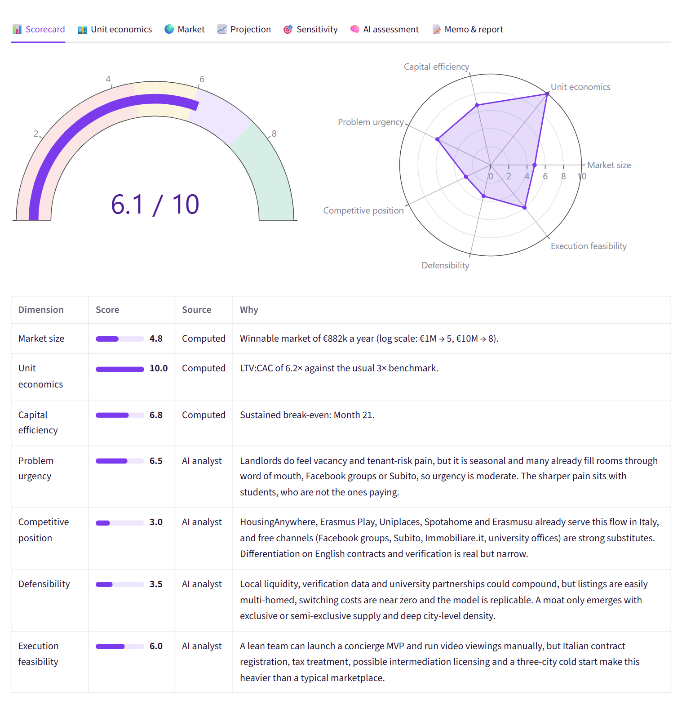
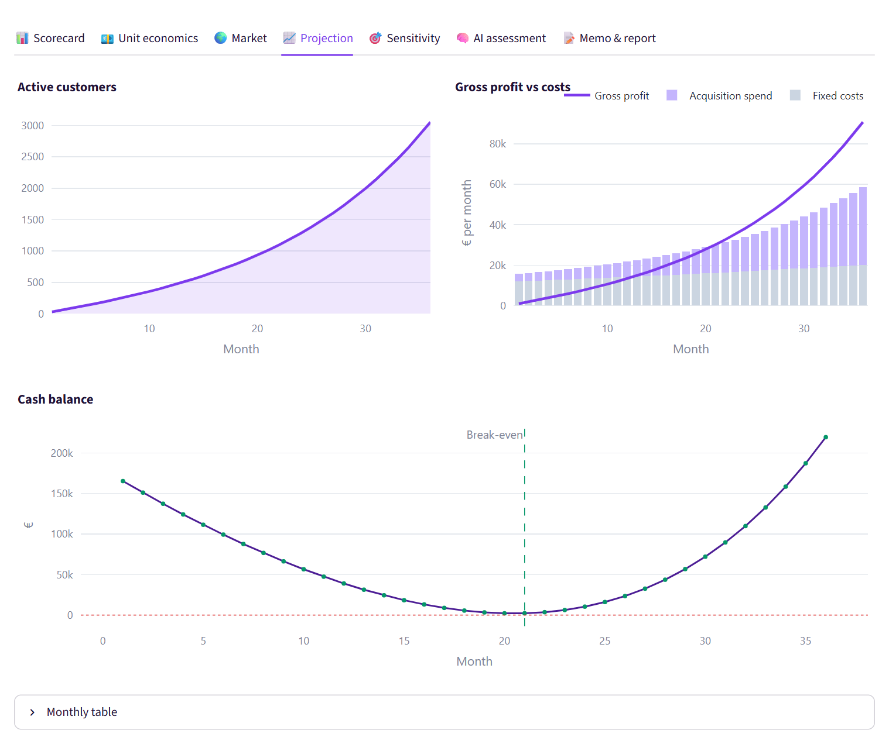
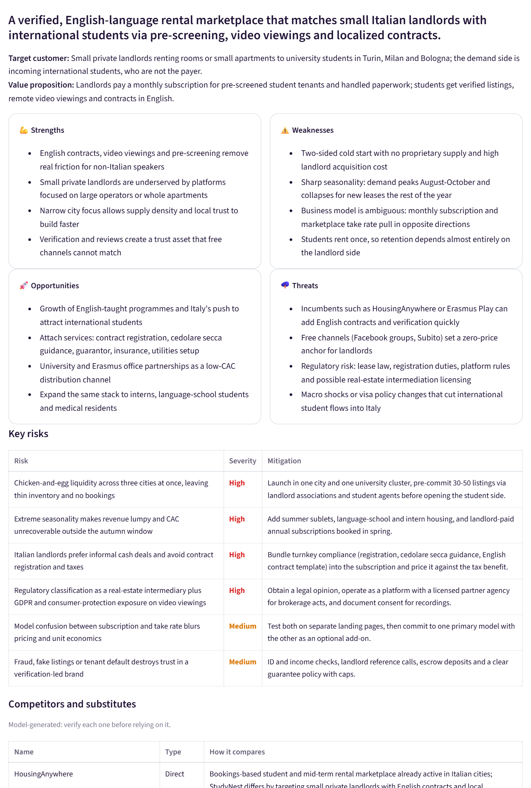
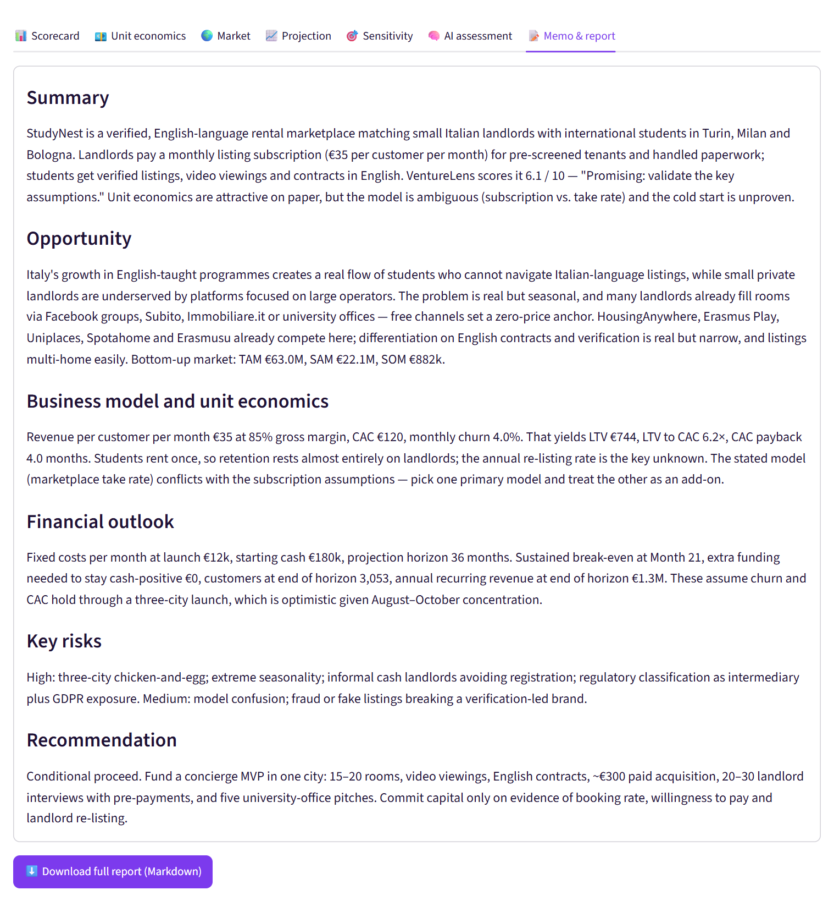
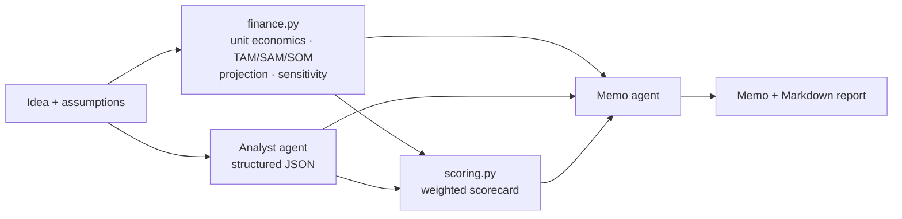

<p align="center">
  
</p>

<p align="center">
  <a href="https://github.com/iamsammy-ak/venturelens-ai/actions/workflows/ci.yml"></a>
  
  
  
  <a href="LICENSE"></a>
</p>

**VentureLens AI** evaluates a business idea the way an early-stage investment committee would. It computes the
numbers investors check first (unit economics, a bottom-up market size, a monthly cash projection and a sensitivity
analysis), then two AI agents add what the numbers can't: the competitive landscape, moats, risks and a written
investment memo.

The split is deliberate: **every figure is calculated in Python, never by the language model.** The model reasons
about the idea and writes; the memo writer receives the computed figures and is instructed to use them verbatim.



## Features

| | |
|---|---|
| 💶 **Unit economics** | Lifetime value, LTV : CAC and CAC payback from price, margin, churn and acquisition cost |
| 🌍 **Market sizing** | Bottom-up TAM → SAM → SOM built from customer counts, not top-down guesses |
| 📈 **Cash projection** | Month-by-month customers, revenue, costs and cash, with sustained break-even and funding gap |
| 🎯 **Sensitivity** | Tornado chart showing which assumption moves the outcome most when changed by ±20% |
| 🧠 **AI analyst** | Structured assessment: problem urgency, competition, defensibility, feasibility, SWOT, risks, investor questions and cheap validation experiments |
| 📝 **Investment memo** | One-page memo grounded in the computed figures, plus a downloadable Markdown report |
| 📊 **Scorecard** | Weighted 0-10 score across seven dimensions, each labelled *computed* or *AI analyst* |

## Screenshots

<table>
  <tr>
    <td width="50%"></td>
    <td width="50%"></td>
  </tr>
  <tr>
    <td align="center"><b>Scorecard</b>: computed and AI-judged dimensions, with reasons</td>
    <td align="center"><b>Projection</b>: customers, costs and cash balance</td>
  </tr>
  <tr>
    <td width="50%"></td>
    <td width="50%"></td>
  </tr>
  <tr>
    <td align="center"><b>AI assessment</b>: SWOT, risks and competitors</td>
    <td align="center"><b>Investment memo</b> that quotes the computed figures</td>
  </tr>
</table>

## How it works



1. **Deterministic model** (`venturelens/finance.py`) turns the assumptions into unit economics, market size, a
   monthly projection and a ±20% sensitivity analysis.
2. **Analyst agent** returns a structured assessment, validated with Pydantic. Lenient validators absorb common
   free-model quirks (`"8/10"`, `"High"`, objects where strings were expected), and an invalid reply gets one automatic
   repair round-trip.
3. **Scorecard** (`venturelens/scoring.py`) combines three computed dimensions with four AI-judged ones. Without an
   AI analysis it shows a clearly marked *partial* score.
4. **Memo agent** writes the memo from the assessment and the computed figures, which it is told are authoritative.

### Key formulas

| Metric | Formula |
|---|---|
| Gross profit per customer per month | price × gross margin |
| Customer lifetime | 1 ÷ monthly churn, capped at 60 months |
| Lifetime value (LTV) | monthly gross profit × lifetime |
| CAC payback | CAC ÷ monthly gross profit |
| TAM → SAM → SOM | customers × annual price → × serviceable share → × winnable share |
| Sustained break-even | first month after which net cash flow never turns negative again |
| Funding gap | max(0, −lowest cash balance) |

### Scorecard

| Dimension | Weight | Source | How it is scored |
|---|---:|---|---|
| Market size | 15% | Computed | Winnable market on a log scale: €1M → 5, €10M → 8, €100M → 10 |
| Unit economics | 20% | Computed | LTV : CAC of 1 → 2.5, 3 → 7.5, 5+ → 10 |
| Capital efficiency | 15% | Computed | Sustained break-even: month 12 → 9, month 24 → 6, month 36 → 3 |
| Problem urgency | 15% | AI analyst | How painful and frequent the problem is |
| Competitive position | 10% | AI analyst | How favourable the landscape is |
| Defensibility | 15% | AI analyst | Network effects, data, switching costs, brand, IP |
| Execution feasibility | 10% | AI analyst | How achievable it is for a small seed-funded team |

### Built for free models

OpenRouter's free models are rate-limited, so the client in `venturelens/llm.py`:

- tries a list of models in order and **skips a busy model** instead of retrying it, saving the daily quota;
- **caches** every successful reply on disk, keyed by a hash of the request, so a repeat run costs nothing;
- validates JSON against the schema and **repairs once** when a reply is malformed or cut off;
- powers a **demo mode**: saved analyses of the sample ideas let anyone explore the app without a key.

## Quick start

```bash
git clone https://github.com/iamsammy-ak/venturelens-ai.git
cd venturelens-ai
python -m venv .venv
source .venv/bin/activate        # Windows: .venv\Scripts\activate
pip install -r requirements.txt
streamlit run app.py
```

The app starts in demo mode. For live AI analysis of your own ideas, get a free key at
[openrouter.ai/keys](https://openrouter.ai/keys) and copy `.env.example` to `.env`:

| Variable | Purpose |
|---|---|
| `OPENROUTER_API_KEY` | Enables live AI analysis |
| `OPENROUTER_MODELS` | Optional comma-separated model list, tried in order |

### Deploy on Streamlit Community Cloud

1. Fork this repository.
2. At [share.streamlit.io](https://share.streamlit.io), create an app pointing at `app.py`.
3. Under **Settings → Secrets**, add `OPENROUTER_API_KEY = "your-key"`.

## Project structure

```
venturelens-ai/
├── app.py                    Streamlit interface
├── venturelens/
│   ├── finance.py            unit economics, market sizing, projection, sensitivity
│   ├── scoring.py            weighted scorecard
│   ├── agents.py             analyst and memo prompts
│   ├── llm.py                OpenRouter client: fallback, cache, JSON repair
│   ├── schemas.py            Pydantic models with lenient validators
│   ├── pipeline.py           glue shared by the app and the scripts
│   ├── report.py             Markdown report export
│   ├── charts.py · ui.py     Plotly figures and styling
│   └── demo.py               sample ideas and saved analyses
├── demo/                     samples.json and saved AI analyses
├── scripts/build_demo.py     regenerates the saved analyses
└── tests/                    unit tests plus a headless run of the whole UI
```

## Testing

```bash
pip install pytest ruff
ruff check . && pytest
```

The suite checks finance identities (closing cash = opening cash + the sum of monthly net flows), break-even edge
cases, scoring monotonicity, JSON extraction and repair, schema coercion and caching, and runs the full Streamlit app
headlessly for every sample idea. CI runs it on every push.

## Limitations

- The projection uses flat churn, price and margin: no cohorts, seasonality or financing events.
- Sample figures are illustrative assumptions, not market data. Replace them with your own evidence.
- AI output can be wrong, especially named competitors; the app labels it and asks you to verify.
- VentureLens is a decision-support tool, not investment advice.

## Roadmap

- [ ] Side-by-side base, bull and bear scenarios
- [ ] Cohort-based retention curves instead of flat churn
- [ ] Web-search grounding for competitor discovery
- [ ] PDF export of the memo

## License

[MIT](LICENSE) © 2026 Abhishek Kumar
